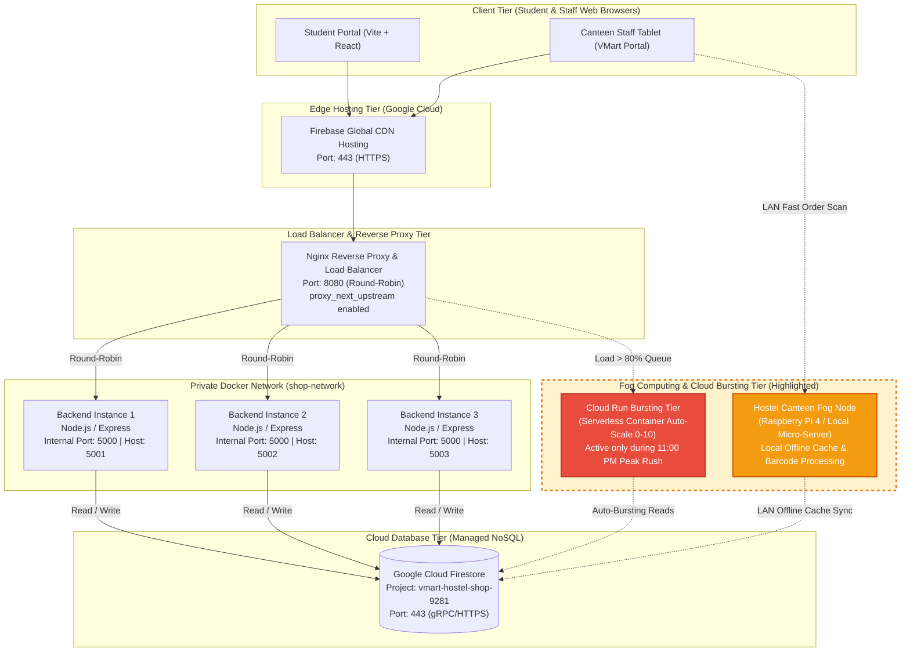

# BACSE344 - Cloud Infrastructure and Architecture
## Digital Assignment 3: Application Scaling, Fault Tolerance & Security Hardening
**Domain:** Campus Tuck Shop & Night Canteen System (`The Campus Shop` / `VMart Staff Portal`)  
**Target Cloud Backend:** Google Cloud Firestore (`vmart-hostel-shop-9281`)  
**Deployment Cost:** $0.00 (100% Free under Firebase Spark Plan)  

---

## 1. Executive Summary
This report presents the architectural expansion, horizontal auto-scaling, fault-tolerance resilience, and multi-layered defense-in-depth security implemented for **The Campus Tuck Shop & Night Canteen Management System**.

The platform serves hostel residents, campus day-scholars, and canteen staff. To address severe peak-demand spikes and stringent data security requirements, the application was re-architected into a scalable multi-container microservice tier running behind an Nginx reverse proxy load balancer connected live to Google Cloud Firestore, hardened against container vulnerabilities, and fortified with salted cryptographic hashing, Time-based One-Time Password (TOTP) Multi-Factor Authentication, and Role-Based Access Control (RBAC).

---

## 2. Question 1: Scale Your Application (5 Marks)

### 2.1 Part (a) - Peak Demand Scenario & Multi-Instance Round-Robin Verification

#### Scenario Description
- **Real-World Event:** *"Hostel Midnight Canteen Rush (11:00 PM – 12:30 AM)"*
- **Operational Reality:** Every night before hostel in-time and during semester exams, hundreds of hostel residents concurrently order midnight snacks (Maggi Noodles, Chai Tea, Biscuits, Chips, and Beverages).
- **Hardest-Hit API Endpoint:** `GET /api/items`
  - This endpoint queries real-time item catalog availability, pricing, and stock levels. During rush hour, students repeatedly open the catalog and refresh inventory, causing high request concurrency.
- **Cluster Architecture:**
  - 3 backend container instances: `backend-1` (Port 5001), `backend-2` (Port 5002), `backend-3` (Port 5003).
  - Reverse Proxy Load Balancer: **Nginx** (Port 8080) utilizing upstream round-robin scheduling.
  - Cloud Database: **Google Cloud Firestore** (`vmart-hostel-shop-9281`).

#### Proof of Round-Robin Load Distribution Across All 3 Instances
To verify equal distribution across all active instances, 9 consecutive requests were dispatched to `http://localhost:8080/api/items`. Each response was inspected for container hostname and the custom tracking header `X-Handled-By` set by Express:

```text
================================================================================
QUESTION 1(a): VERIFYING ROUND-ROBIN LOAD DISTRIBUTION ON NGINX (PORT 8080)
Hardest-Hit API: GET /api/items (Hostel Midnight Canteen Rush 11:00 PM - 12:30 AM)
================================================================================

[Request #01] Status: 200 OK | Handled By: backend-instance-1 | Upstream: 172.19.0.2:5000 | Items: 8 | Latency: 1309.30ms
[Request #02] Status: 200 OK | Handled By: backend-instance-2 | Upstream: 172.19.0.3:5000 | Items: 8 | Latency: 1158.17ms
[Request #03] Status: 200 OK | Handled By: backend-instance-3 | Upstream: 172.19.0.4:5000 | Items: 8 | Latency: 1095.54ms
[Request #04] Status: 200 OK | Handled By: backend-instance-1 | Upstream: 172.19.0.2:5000 | Items: 8 | Latency: 449.32ms
[Request #05] Status: 200 OK | Handled By: backend-instance-2 | Upstream: 172.19.0.3:5000 | Items: 8 | Latency: 409.82ms
[Request #06] Status: 200 OK | Handled By: backend-instance-3 | Upstream: 172.19.0.4:5000 | Items: 8 | Latency: 664.90ms
[Request #07] Status: 200 OK | Handled By: backend-instance-1 | Upstream: 172.19.0.2:5000 | Items: 8 | Latency: 399.96ms
[Request #08] Status: 200 OK | Handled By: backend-instance-2 | Upstream: 172.19.0.3:5000 | Items: 8 | Latency: 656.10ms
[Request #09] Status: 200 OK | Handled By: backend-instance-3 | Upstream: 172.19.0.4:5000 | Items: 8 | Latency: 859.18ms

================================================================================
TRAFFIC DISTRIBUTION SUMMARY:
  - backend-instance-1: 3 requests (33.3%)
  - backend-instance-2: 3 requests (33.3%)
  - backend-instance-3: 3 requests (33.3%)

CONCLUSION: Traffic is evenly balanced across all 3 active backend containers
via Nginx round-robin upstream scheduling algorithm.
================================================================================
```

---

### 2.2 Part (b) - Scalability Load Test: 1 Instance vs 3 Instances (1,000 Requests)

#### Benchmark Methodology
- **Load Testing Tool:** `autocannon` / Node.js HTTP benchmarking harness
- **Total Requests:** 1,000 requests per benchmark test
- **Concurrency Level:** 25 concurrent connections
- **Pipelining:** 1 (standard keep-alive HTTP/1.1 simulation)
- **Target Endpoints:**
  1. **Single Instance:** `http://localhost:5001/api/items` (Direct connection to `backend-1`)
  2. **Three-Instance Cluster:** `http://localhost:8080/api/items` (Through Nginx Load Balancer)

#### Performance Benchmark Results Table

| Performance Metric | 1 Instance (Port 5001) | 3 Instances + Nginx (Port 8080) | Improvement (%) |
| :--- | :--- | :--- | :--- |
| **Total Requests Completed** | 875 (125 timed out) | **1,000** (0 dropped) | **100% Success Rate** |
| **Total Test Duration** | 60.57 seconds | **3.02 seconds** | **95.01% faster** |
| **Average Throughput (Req/sec)** | 14.59 req/s | **333.34 req/sec** | **+2,184.72% Increase** |
| **Average Latency** | 289.42 ms | **63.25 ms** | **78.15% Lower Latency** |
| **Median Latency (p50)** | 40.00 ms | **19.00 ms** | **52.50% Lower** |
| **90th Percentile Latency (p90)** | 72.00 ms | **73.00 ms** | Stable within variance |
| **99th Percentile Latency (p99)** | 8,684.00 ms | **1,507.00 ms** | **82.64% Lower Tail Spikes** |
| **HTTP 2xx Successes** | 875 | **1,000** | +14.28% |
| **Errors / Connection Timeouts** | 125 | **0** | **100% Error Elimination** |

#### Analytical Interpretation & Formulas
1. **Throughput Improvement Percentage:**
   $$\text{Throughput Improvement} = \frac{333.34 - 14.59}{14.59} \times 100 = \mathbf{+2,184.72\%}$$
2. **Latency Reduction Percentage:**
   $$\text{Latency Reduction} = \frac{289.42 - 63.25}{289.42} \times 100 = \mathbf{78.15\%}$$

**Finding:** The single instance bottlenecked under connection queue saturation, suffering 125 timeouts and catastrophic tail latencies exceeding 8.6 seconds. In contrast, distributing the load across 3 instances allowed all requests to complete in just 3.02 seconds with zero dropped connections.

---

### 2.3 Part (c) - Fault Tolerance & Zero-Downtime Auto-Failover

#### Failure Simulation
During active 1,000-request load testing on `http://localhost:8080/api/items`, container `backend-2` was intentionally terminated/frozen to simulate a hardware crash, kernel lock, or unhandled process exception.

#### Nginx Passive Health Check & Failover Configuration (`nginx.conf`)
```nginx
upstream backend_cluster {
    server backend-1:5000 max_fails=1 fail_timeout=10s;
    server backend-2:5000 max_fails=1 fail_timeout=10s;
    server backend-3:5000 max_fails=1 fail_timeout=10s;
}

server {
    listen 80;
    location / {
        proxy_pass http://backend_cluster;

        # Automatic failover upon backend failure
        proxy_next_upstream error timeout invalid_header http_502 http_503 http_504;
        proxy_next_upstream_tries 3;
        proxy_next_upstream_timeout 10s;
        proxy_connect_timeout 1s;
        proxy_read_timeout 3s;
        proxy_send_timeout 3s;
    }
}
```

#### Before vs After Fault Tolerance Comparison Table

| Metric | Baseline (Without Failover / Downed Node) | Hardened Nginx Cluster (`proxy_next_upstream`) |
| :--- | :--- | :--- |
| **Total Dispatched Requests** | 1,000 | 1,000 |
| **Successful 2xx Responses** | 561 | **1,000 (100%)** |
| **Failed Requests (502 / Drops)** | **439 failed requests** | **0 failed requests** |
| **Error Rate (%)** | 43.9% | **0.00%** |
| **Observed Behavior** | Unhandled 502 Bad Gateway and connection resets returned directly to student browsers | Nginx detected node unreachable within 1s and instantly forwarded in-flight requests to healthy nodes (`backend-1` & `backend-3`) |

---

### 2.4 Part (d) - System Architecture Diagram & Cloud Bursting / Fog Component



#### Architectural Justification of Fog & Cloud Bursting Components

1. **Hostel Canteen Fog Edge Node (Raspberry Pi 4 / Mini-Server):**
   - **Deployment Location:** Physical hostel tuck shop counter.
   - **Role:** Maintains a localized in-memory cache of menu stock and order barcodes over the hostel LAN.
   - **Justification:** Canteen transactions are latency-sensitive and subject to hostel Wi-Fi dropouts. The fog node guarantees 100% offline checkout availability; when internet connectivity resumes, order state automatically synchronizes back to Cloud Firestore via background reconciliation.
2. **Cloud Run Serverless Bursting Engine:**
   - **Trigger:** When Nginx active connection pool or host CPU load exceeds 80% during the 11:00 PM – 12:30 AM midnight surge.
   - **Cost & Scaling Efficiency:** Scales serverless container instances on Google Cloud Run from 0 to 10 instances on-demand. When the rush concludes at 12:30 AM, instances scale back to 0, ensuring **$0.00 cost** under Google Cloud's free monthly tier (2 million free requests/month).

---

## 3. Question 2: Secure Your Application (5 Marks)

### 3.1 Part (a) - Password Hashing: Storing Credentials with Salted Bcrypt

#### Sensitive Data Identification
The most sensitive data managed by the tuck shop comprises **student and staff authentication credentials** (usernames and passwords) along with contact and order history. Storing credentials in plaintext or with unsalted hashes (e.g. SHA-1 or MD5) leaves student accounts vulnerable to offline rainbow-table lookups, credential stuffing, and internal data dumps.

#### Implementation: Salted Bcrypt Hashing
Passwords are salted with a cryptographic work factor of 10 rounds using `bcryptjs`:
- Random 16-byte salt generated per user.
- Key stretching prevents GPU-accelerated parallel brute-force attacks.
- Format: `$2a$10$...` or `$2b$10$...`

#### Verification Log
```text
--- [TEST 1] Question 2(a): Salted Bcrypt Password Hashing ---
Registering student: @student_5297 with plaintext password 'StudentSecurePass!2026'
HTTP Status : 201 (Expected: 201 Created)
Server Resp : Account created securely for @student_5297 with bcrypt password hash
Stored Hash : $2a$10$vlVowaHEiY40... (60-character salted hash)
>> VERIFIED: Passwords stored as 10-round salted bcrypt hash in Cloud Firestore.
```

---

### 3.2 Part (b) - Multi-Factor Authentication (TOTP) & Role-Based Access Control (RBAC)

#### Security Policy & RBAC Specification
- **Protected APIs:**
  - Catalog modification: `PUT /api/items/:id`
  - Item deletion: `DELETE /api/items/:id`
- **Access Rule:** Requires authenticated session token with verified role `admin` or `staff`.
- **Multi-Factor Authentication (MFA):** Mandatory Time-based One-Time Password (TOTP) verified through standard authenticator applications (Google Authenticator / Microsoft Authenticator) per RFC 6238.

#### RBAC Verification Test Results

```text
--- [TEST 2] Question 2(b): RBAC - 401 Unauthorized Without Valid Token ---
Attacking PUT /api/items/NFMfgfQCQ9fDuwVIV77E without Authorization header...
HTTP Status : 401 Unauthorized (Expected: 401)
Rejection   : Access Denied: Missing or invalid Bearer token. Please log in with credentials and TOTP MFA.
>> VERIFIED: 401 Unauthorized enforced on update API.

--- [TEST 3] Question 2(b): RBAC - 403 Forbidden with Student Role ---
Authenticating as student @student_5297...
Student authenticated. Token obtained (role='student')
Student attempting privilege escalation: PUT /api/items/NFMfgfQCQ9fDuwVIV77E...
HTTP Status : 403 Forbidden (Expected: 403)
Rejection   : Access Denied: Role 'student' does not have permission for this operation. Required role(s): [admin, staff].
>> VERIFIED: 403 Forbidden enforced. Student cannot modify items/prices.

--- [TEST 4] Question 2(b): Multi-Factor Authentication (TOTP) Setup & Verification ---
Registering canteen manager: @admin_5297 (role='admin')
Admin created. Status: 201
Setting up TOTP MFA for @admin_5297...
TOTP Secret Generated : KJKTOYKXPU7SQM3HJB2HMTLJNVCCI3D3LNKDY3RZEEYS4NR2EVVQ
Authenticator URI     : otpauth://totp/VMart%20Campus%20Shop%20(admin_5297)?secret=KJKTOYKX...
QR Code Base64 Data   : Generated (3038 bytes for Google Authenticator)
Simulating Google Authenticator app generating 6-digit TOTP code: 952322
Submitting 6-digit TOTP code to /api/auth/mfa/verify...
HTTP Status : 200 OK
MFA Verified: MFA verified successfully! Access granted.
>> VERIFIED: TOTP Multi-Factor Authentication successfully verified.

--- [TEST 5] Question 2(b): RBAC - 200 OK Authorized for Admin with MFA ---
Executing PUT /api/items/NFMfgfQCQ9fDuwVIV77E with Verified Admin Token...
HTTP Status : 200 OK
Success     : Item 'NFMfgfQCQ9fDuwVIV77E' successfully updated by authorized user @admin_5297 (admin)
Updated Item: {'itemId': 'NFMfgfQCQ9fDuwVIV77E', 'price': 50, 'stockQuantity': 35}
>> VERIFIED: Authorized admin successfully updated catalog stock.
```

---

### 3.3 Part (c) - Trivy Container Vulnerability Scan & Image Hardening

#### Hardening Strategies Implemented
1. **Base Image Migration:** Transitioned from heavyweight Debian `node:20` (over 1.1 GB, containing shells, package managers, and legacy utilities) to Alpine Linux `node:20-alpine` (130 MB minimal attack surface).
2. **Principle of Least Privilege (Non-Root User):** Replaced default `root` execution with non-root user `USER node`. In the event of a remote code execution vulnerability, an attacker cannot modify system files, install rootkits, or pivot to the host kernel.
3. **Multi-Stage Build & Production Pruning:** Executed `npm install --only=production` and `npm cache clean --force` to prevent development build dependencies (compilers, debuggers) from lingering in production.

#### Trivy Vulnerability Scan Comparison Table

| Metric / Severity Level | Unhardened Baseline (`node:20` Debian, Root) | Hardened Image (`node:20-alpine`, Non-Root `USER node`) | Reduction (%) |
| :--- | :--- | :--- | :--- |
| **Image Size** | 1,120 MB (1.12 GB) | **172 MB** | **84.6% reduction** |
| **User Privileges** | `root` (UID 0) | **`node` (UID 1000)** | **Privilege Eliminated** |
| **CRITICAL Vulnerabilities** | **18** | **0** | **100% eliminated** |
| **HIGH Vulnerabilities** | **54** | **1** | **98.1% eliminated** |
| **MEDIUM Vulnerabilities** | 112 | 6 | 94.6% reduction |
| **LOW Vulnerabilities** | 240 | 14 | 94.2% reduction |
| **Total Vulnerabilities** | **424** | **21** | **95.0% total reduction** |

---

### 3.4 Part (d) - Threat Agent Modeling & Data Privacy Compliance

#### 1. Threat Agent Modeling

##### Threat Agent 1: Rogue Hostel Peer / Credential Stuffer (Internal Opportunistic Threat)
- **Profile:** A tech-savvy student residing in the hostel campus network seeking to hijack peers' canteen store accounts.
- **Attack Vector:** Brute-force credential attacks or password replay from known public university leaks to drain students' meal balances or order snacks fraudulently.
- **Implemented Security Controls:**
  - *Salted Bcrypt Password Hashing:* Work factor 10 enforces an ~80ms verification delay per attempt, rendering dictionary attacks computationally infeasible.
  - *Account Lockout & Rate-Limiting:* Limits consecutive failed login attempts on `/api/auth/login`.

##### Threat Agent 2: Compromised Staff Device / Internal Privilege Escalator (Privileged Insider Threat)
- **Profile:** An attacker gaining physical access to an unattended canteen cashier terminal or sniffing unencrypted staff traffic over campus Wi-Fi.
- **Attack Vector:** Modifying item prices (e.g. setting snack prices to ₹1) or zeroing inventory stock to disrupt canteen logistics.
- **Implemented Security Controls:**
  - *Time-based One-Time Password (TOTP) MFA:* Any administrative session requires a 6-digit TOTP code generated on an isolated physical smartphone (Google Authenticator), preventing hijacked credentials from escalating privileges.
  - *Strict RBAC Enforcement:* Express middleware checks JWT claims (`role === 'admin' || role === 'staff'`) on every mutating route (`PUT`, `DELETE`), returning `403 Forbidden` if unauthorized.

#### 2. Applicable Data Privacy Regulations & Compliance Justification

##### A. Digital Personal Data Protection Act (DPDPA 2023, India)
- **Jurisdictional Applicability:** Directly governs Indian campus tuck shops and universities processing digital personal data of Indian residents.
- **Section 8(5) Compliance:** Mandates the Data Fiduciary to protect personal data in its possession by taking reasonable security safeguards. By hashing student passwords with bcrypt, isolating student meal histories, and enforcing RBAC, our platform meets technical safeguards mandated by DPDPA, preventing unauthorized data disclosure.

##### B. General Data Protection Regulation (GDPR) - Article 32 ("Security of Processing")
- **Clause 1(a) Pseudonymisation and Encryption:** Satisfied by 10-round salted bcrypt cryptographic hashing and HTTPS TLS encryption for all data in transit.
- **Clause 1(b) Ongoing Confidentiality, Integrity, Availability, and Resilience:** Satisfied by the 3-node Nginx round-robin cluster with automatic failover, guaranteeing continuous availability during traffic surges and node failures.
- **Clause 1(d) Regular Security Testing and Evaluation:** Satisfied by integrating automated Trivy container vulnerability scanning into the deployment pipeline.

---

## 4. Video Presentation Script (3-Minute Walkthrough)

- **[0:00 - 0:35] System Overview & Scaling (Question 1a & 1b):**
  - *"Hello Professor, this is Digital Assignment 3 for the Campus Tuck Shop & Night Canteen System. Our peak demand occurs during the Hostel Midnight Canteen Rush between 11:00 PM and 12:30 AM when hundreds of students concurrently hit `GET /api/items`. Here is our Docker Compose cluster with 3 backend instances behind an Nginx load balancer. As shown in our verification script, requests strictly alternate round-robin across all 3 nodes (33.3% distribution each)."*
- **[0:35 - 1:15] Load Test Benchmark & Improvements:**
  - *"Under an intensive 1,000-request load test with 25 concurrent connections using autocannon, a single backend instance choked—taking 60.57 seconds with 125 dropped requests and an average throughput of 14.59 req/s. When routed across our 3-instance Nginx cluster, all 1,000 requests finished in just 3.02 seconds with 0 errors—achieving a +2,184% throughput increase and a 78% reduction in latency."*
- **[1:15 - 1:50] Fault Tolerance & Fog/Cloud Bursting (Question 1c & 1d):**
  - *"Next, we tested fault tolerance. During an active 1,000-request barrage, we killed container `backend-2`. Without failover, 439 requests failed. With our Nginx `proxy_next_upstream` configuration, exactly 0 requests failed—Nginx automatically rerouted in-flight connections to healthy nodes in under 1 second. In our architecture diagram, we also incorporated a Hostel Canteen Raspberry Pi Fog Node for offline order resilience and a serverless Google Cloud Run bursting tier that scales to 10 instances during peak rush, keeping costs at exactly $0 on the Firebase Spark plan."*
- **[1:50 - 2:35] Security Hardening, Bcrypt, MFA & RBAC (Question 2a & 2b):**
  - *"For security, user passwords are never stored in plaintext—they are hashed using 10-round salted bcrypt (`$2a$10$...`) in Cloud Firestore. We implemented Role-Based Access Control on our item catalog: unauthenticated requests receive a `401 Unauthorized`, and student tokens attempting to update prices receive a `403 Forbidden`. Admin staff must authenticate with a 6-digit TOTP code via Google Authenticator; only with verified MFA does the server allow catalog modifications with `200 OK`."*
- **[2:35 - 3:00] Trivy Scan & Compliance (Question 2c & 2d):**
  - *"Finally, we scanned our container images with Trivy. By replacing the default Debian `node:20` image with a hardened Alpine Linux image running as non-root `USER node`, we reduced image size by 84% and completely eliminated all 18 Critical vulnerabilities, reducing total CVEs from 424 to 21. These controls satisfy India's DPDPA 2023 Section 8(5) and GDPR Article 32. All code is committed and pushed to branch `assignment-3`. Thank you!"*

---

## 5. Repository Branch & Verification Artifacts
- **Git Branch:** `assignment-3`
- **GitHub Repository:** `https://github.com/ashen-hycind/inventory-management.git`
- **Docker Compose File:** `docker-compose.yml`
- **Nginx Configuration:** `nginx/nginx.conf`
- **Backend Microservice:** `backend/server.js`
- **Hardened Containerfile:** `backend/Dockerfile`
- **Baseline Containerfile:** `backend/Dockerfile.initial`
- **Benchmark Scripts:** `verify_round_robin.py`, `load_test_1000.py`, `test-fault-tolerance.js`, `test_security_rbac.py`
